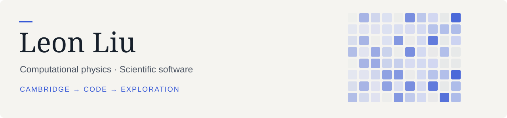

<picture>
  
</picture>

I'm Leon, a **Natural Sciences (Physics) graduate from the University of Cambridge**, Magdalene College. I use code to investigate physical systems, analyse experimental data, and build things people can interact with.

My work spans Monte Carlo experiments, density functional theory, and scientific Python — alongside game development and small web apps.

[**Portfolio ↗**](https://kaworuikari.github.io/) · [Rewild](https://kaworuikari.github.io/Gamejam21/) · [Just Memo It](https://kaworuikari.github.io/just_memo_it/)

### Selected work

| Project | What I worked on | Tools |
| :--- | :--- | :--- |
| **Wavefunction Collapse** ¹ | Vectorised constraint solving and Monte Carlo experiments on pattern generation. Cambridge computational physics project, **82.5/100**. | Python · NumPy |
| [**Surface potential modelling**](https://github.com/KaworuIkari/pseudopotential_calculator) | DFT modelling of Cu(111) surfaces and Na/K adsorption, using a shared research codebase; convergence tests and potential-energy mapping. | Python · ASE · CASTEP |
| [**Rewild · 归野**](https://github.com/KaworuIkari/Gamejam21) | A cosy 3D restoration game made with a three-person team. My contributions include watering mechanics, quests, scene effects, and the project website. | Godot · GDScript |
| [**NMR analysis**](https://github.com/KaworuIkari/E2b_NMR) | T₁/T₂ curve fitting, temperature and concentration dependence, and uncertainty analysis for laboratory experiments. | Python |
| [**Just Memo It**](https://github.com/KaworuIkari/just_memo_it) | A minimal vocabulary app with spaced repetition, offline use, and progress saved in the browser. | JavaScript · HTML · CSS |

¹ Code is in a private course repository. The surface-potential link is my fork of [Matt Ord’s research framework](https://github.com/Matt-Ord/pseudopotential_calculator).

### Background

- **Cambridge, 2023–2026** — BA Natural Sciences (Physics); Part I First Class, Part II 2:1.
- **Surface Physics Laboratory** — computational modelling of metal surfaces and adsorption.
- **AI Speech** — development internship reviewing evaluation methods across 27 speech and NLP tasks.
- **Teaching** — British Physics Olympiad coaching and IELTS tutoring.

**Also exploring:** [neural networks from scratch](https://github.com/KaworuIkari/neural-network-from-scratch), following Andrej Karpathy's micrograd and makemore series.

---

[Website](https://kaworuikari.github.io/) · [Email](mailto:leonliu663@gmail.com)
